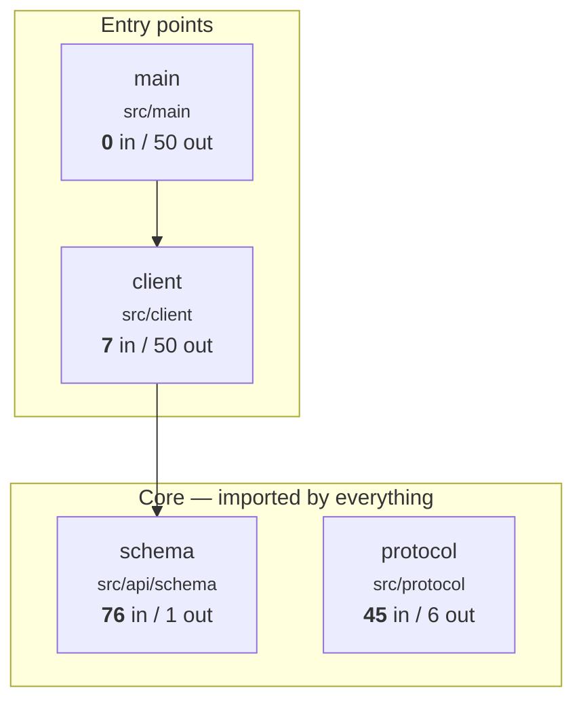

# Repo Cartographer

Explain any codebase in one command.

Point it at a repository and get two things a new maintainer actually needs: a
**diagram of how the system is put together**, and a written briefing on what to
read first. Both come from the same structural scan, which runs without a model.

Built for the **Cerebras × Kimi K3.1 Pro Hackathon**. The model only sees a
compressed map of the repo, never the source — that is what makes it fast.

## Why it is fast

Two stages, deliberately separated:

1. **Structural index (no LLM).** Walks the repo, detects languages, finds
   manifests, parses imports, builds an internal import graph, ranks the
   most-imported modules, and identifies entry points. Runs in milliseconds —
   an 800-file repo indexes in about 180 ms.
2. **Reasoning (Kimi on Cerebras).** The index is compressed into a dense
   prompt and sent to the model. Because the index already did the expensive
   work, the model receives a small, high-signal payload instead of raw source.

That split is why it is fast: the model never reads your source, it reads a map
of it.

## Install

```bash
git clone <repo> && cd repo-cartographer
export CEREBRAS_API_KEY=csk-...        # https://cloud.cerebras.ai
```

No dependencies. Node 20+ only.

## Usage

```bash
# Full briefing
node cartographer.mjs /path/to/repo

# A module-level diagram, renders natively on GitHub
node cartographer.mjs . --mermaid

# Ask a specific question
node cartographer.mjs . -q "where is authentication handled?"

# Structural index only, no LLM call
node cartographer.mjs . --json > index.json

# Save the briefing
node cartographer.mjs . -o BRIEFING.md
```

Or install the binary:

```bash
npm link
cartographer /path/to/repo
```

## The diagram

`--mermaid` prints a flowchart you can paste straight into a README — GitHub,
GitLab and most markdown viewers render it without extra tooling.

Modules are grouped into **architectural layers inferred from the import graph
itself**, so the diagram shows how the system is shaped instead of a wall of
boxes:

| Layer | Detected by |
| --- | --- |
| **Entry points** | Known entries (`main`, `cli`), or barely imported code |
| **Core** | Imported by a large share of the repo — the load-bearing code |
| **Boundaries** | Wide fan-in *and* fan-out; interfaces others route through |
| **Leaves** | Mostly consumed, import little |

Each box shows the module path and its degree as `<b>in</b> in / out`. Arrow
weight encodes how many import statements connect two modules, so `==>` marks
the heaviest coupling.



Only modules that take part in cross-module imports appear; isolated files add
noise, not structure. Unconnected code is reported in the briefing instead.

Tuning:

```bash
node cartographer.mjs . --mermaid --depth 1        # coarser grouping
node cartographer.mjs . --mermaid --max-modules 30 # more boxes
node cartographer.mjs . --mermaid --flat           # no layer bands
node cartographer.mjs . --mermaid -o ARCH.md       # save it
```

`--depth` controls how many directory levels define a module. At depth 1 you get
`src/api`; at depth 2 you get `src/api/schema`. A file that sits next to its
siblings (`src/layout.rs`) stays its own module rather than collapsing into the
parent directory, which would otherwise merge unrelated code into one box.

## Options

| Flag | Meaning |
| --- | --- |
| `-q, --question <text>` | Ask one question instead of a briefing |
| `-m, --model <id>` | Cerebras model id (default Kimi K3.1 Pro trial) |
| `-o, --out <file>` | Write output to a file |
| `-j, --json` | Print the raw index, no model call |
| `--mermaid` | Print a Mermaid diagram, no model call |
| `--depth <n>` | Module depth for `--mermaid` (default 2) |
| `--max-modules <n>` | Modules in the diagram (default 18) |
| `--max-files <n>` | Scan limit (default 25000) |
| `--timeout <s>` | Request timeout (default 180) |
| `--reasoning <lvl>` | `reasoning_effort`: low, medium, high |

Environment: `CEREBRAS_API_KEY`; set `REPO_CARTOGRAPHER_DEBUG=1` to dump the
prompt.

## What the briefing contains

- **What this is** — purpose and stack in plain language
- **Architecture** — the major parts and how they relate
- **Where to start reading** — an ordered list of files, each with a reason
- **Main flow** — how a request travels from entry point to output
- **Risky or complex areas** — where a newcomer breaks things
- **First tasks** — three concrete things to do this week

## How the index works

`src/indexer.mjs` does the structural work:

- Skips `node_modules`, `.git`, build output, virtualenvs, caches
- Detects language per file across about 30 extensions
- Parses `package.json`, `Cargo.toml`, `pyproject.toml`, `go.mod`
- Extracts imports for TS/JS/Python/Rust/Go and resolves relative paths into an
  internal graph
- Ranks files by how many others import them — that is the de facto core
- Scores entry points by filename, `bin`/`main` manifest fields, and convention
- Samples README, `AGENTS.md` and `CLAUDE.md` for project conventions

Everything is bounded (file count, depth, bytes per file) so a monorepo cannot
hang it.

## Project layout

```text
cartographer.mjs     CLI, argument parsing, output formatting
src/indexer.mjs      structural scan and import graph
src/mermaid.mjs      module-level diagram export
src/prompt.mjs       index to prompt compression
src/cerebras.mjs     Cerebras Inference API client with timing breakdown
bench.mjs            benchmark across repositories
```

## Measured on real repos

Scan time is model-free and stays flat as repositories grow:

| repo | stack | files | source | scan |
| --- | --- | --- | --- | --- |
| ohmycaptcha | Python | 76 | 18 | 13 ms |
| gorm | Go | 174 | 163 | 18 ms |
| OpenSign | JS | 678 | 532 | 206 ms |
| got | TypeScript | 227 | 197 | 31 ms |
| open-design | TypeScript | 2,494 | 965 | 969 ms |
| herdr | Rust | 1,737 | 516 | 201 ms |
| lightdash | TypeScript | 12,626 | 10,911 | 13.4 s |

On `herdr` (1,737 files, 516 source): 3.1M tokens of source compress to 3,929
tokens of map — **799x** — which is what makes the model call cheap.

### On throughput numbers

Cerebras returns a server-side timing breakdown, and the split matters:

```text
queue       20 ms   waiting for capacity
prefill     61 ms
decode     940 ms
speed    1762.8 tok/s   (decode only)
```

That is `gpt-oss-120b`. The hackathon's `moonshotai-kimi-k3.1-pro-trial` is a
reasoning model: excellent output, but during a busy event its `queue_time`
reached 90+ seconds while decode stayed around 250 tok/s. The tool reports
**decode throughput** and shows queue separately, because folding a congested
queue into a tok/s figure reports the platform, not the model. Both models work:

```bash
node cartographer.mjs . --model gpt-oss-120b              # 1.7 s on 1,737 files
node cartographer.mjs . --model moonshotai-kimi-k3.1-pro-trial
```

A full briefing for `herdr` is around 1,600 output tokens, and reads like this:

> `src/pane/terminal.rs`, `src/pane.rs` and `src/terminal/state.rs` are enormous
> and combine stateful, byte-oriented behavior. `crates/ghostty-vt/src/bindings.rs`
> is generated/native-facing code.
>
> `src/api/schema.rs` is imported by 76 files. Changes can affect the CLI, socket
> clients, subscriptions, persistence, and the published schema.

Those are real paths and real coupling from the index, not generic advice.

## Tests

```bash
node --test
```

## License

MIT
